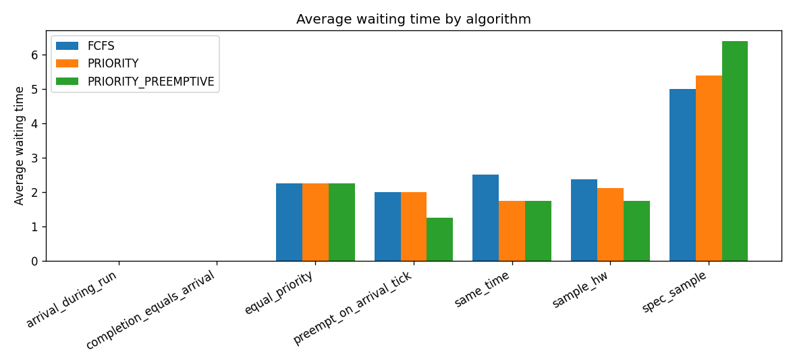
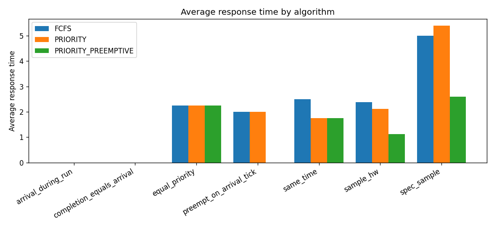
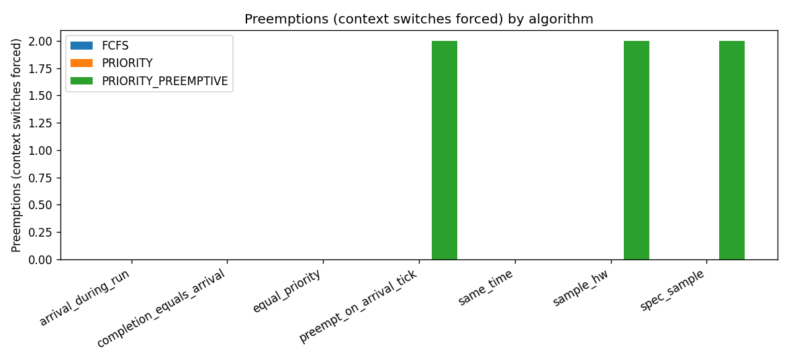

# Hospital scheduler

CS-3710 Operating Systems, Assignment 1 (Process Management).
Scenario: **Emergency Hospital Management**. Patients are processes and the
two doctors are two identical parallel service units.

Group: **Doc, she's losing blood!**

Implemented algorithms:

- `FCFS`: first-come, first-served (non-preemptive)
- `PRIORITY`: non-preemptive priority scheduling
- `PRIORITY_PREEMPTIVE`: preemptive priority scheduling

## Project layout

```text
src/        C sources (main, io, three schedulers, stats, gantt, compare)
tests/      regression tests (inputs, expected, invalid, run_tests.sh)
analysis/   algorithm comparison (compare.sh, plot.py, results, graphs)
```

## Compile

From the project directory:

```sh
gcc -std=c11 -Wall -Wextra -Wpedantic -Werror -pthread src/*.c -o scheduler
```

`cc` or `clang` work as well. `src/*.c` picks up every source file, so
nothing needs editing when a file is added.

## Run

```sh
./scheduler INPUT_FILE ALGORITHM [--gantt] [--stats]
```

| Argument | Meaning |
|---|---|
| `INPUT_FILE` | input file in the format below |
| `ALGORITHM` | `FCFS`, `PRIORITY`, `PRIORITY_PREEMPTIVE`, `COMPARE` or `COMPARE_CSV` |
| `--gantt` | (optional) print a per-doctor timeline to **stderr** |
| `--stats` | (optional) print preemption/dispatch counts to **stderr** |

```sh
./scheduler tests/inputs/sample_hw.txt FCFS
./scheduler tests/inputs/sample_hw.txt PRIORITY_PREEMPTIVE --gantt --stats
./scheduler tests/inputs/sample_hw.txt COMPARE
```

stdout always stays in the machine-readable format below. Extra output goes
to stderr.

## Input format

```text
N
Q
ID,ARRIVAL,PRIORITY,SERVICE,CATEGORY
...
```

`N` is the patient count and `Q` the Round Robin quantum (read but unused by
these algorithms). Lower priority numbers are served first. Blank lines and
lines starting with `#` are ignored. Inputs are rejected (non-zero exit, nothing
on stdout) for: a count that does not match the records, a missing or
non-numeric field, a negative number, a zero service time, an ID of 32
characters or more, and a duplicate ID.

## Output format

One row per patient in lexicographic ID order, then a summary block:

```text
PROCESS_ID,ARRIVAL,PRIORITY,SERVICE,START,COMPLETION,WAITING,TURNAROUND,RESPONSE
...
SUMMARY
AVERAGE_WAITING,...
AVERAGE_TURNAROUND,...
AVERAGE_RESPONSE,...
THROUGHPUT,...
UTILIZATION,...
```

`UTILIZATION` is a percentage without the `%` sign.

## Testing

```sh
sh tests/run_tests.sh
```

The script compiles the program, then runs four groups of checks (47 in total):

1. **Valid inputs:** each of the 12 files in `tests/inputs/` is run with all
   three algorithms and stdout is compared with `tests/expected/<case>_<ALGO>.out`.
2. **Invalid inputs:** each file in `tests/invalid/` must exit non-zero with
   empty stdout, as must an unknown algorithm name and a missing file.
3. **Flags:** `--gantt --stats` must not change stdout.
4. **Compare mode:** `COMPARE_CSV` must output a header and one row per algorithm.

Every run has a 10 second timeout so a scheduler stuck in a loop fails instead
of hanging the suite.

| Input | Edge case (spec Section 17) |
|---|---|
| `single` | one process |
| `same_time` | all processes arrive at time 0 |
| `arrival_during_run` | processes arriving while another runs |
| `equal_priority` | equal priorities (must not preempt) |
| `identical` | identical arrival, priority and service |
| `idle_gap` | long idle period (arrival at time 1000) |
| `long_service` | very long job (50000 units) next to very short ones |
| `preempt_on_arrival_tick` | preemption at the exact tick of an arrival |
| `completion_equals_arrival` | a completion and an arrival at the same time |
| `lexicographic_ids` | `P10` vs `P2` ordering |
| `sample_hw`, `spec_sample` | mixed workloads; spec Section 13.4 sample |

**How the expected files were produced.** They were not copied from the C
program. `tests/reference_sim.py` is an independent model that advances one time
unit at a time (no event jumping, no heap) and follows spec Sections 7 to 10
literally. Several cases were also traced by hand and matched. To check the
suite detects real bugs, three defects were planted in a scratch copy
(equal priorities preempting, FCFS ties broken by the larger ID, duplicate IDs
accepted) and each was reported as a failure.

To add a case: put `name.txt` in `tests/inputs/`, run
`python3 tests/reference_sim.py tests/inputs/name.txt ALGO > tests/expected/name_ALGO.out`
for each algorithm, and **check the result by hand** before committing it.

## Algorithm comparison

Run on the `sample_hw` input (8 patients) and the specification sample
`spec_sample` (5 patients). Reproduce with
`./scheduler tests/inputs/sample_hw.txt COMPARE`.

**sample_hw**

| Algorithm | AvgWait | AvgTAT | AvgResp | Throughput | Util % | Preempt | Dispatch | Max queue | Longest wait |
|---|---|---|---|---|---|---|---|---|---|
| FCFS | 2.38 | 5.50 | 2.38 | 0.4706 | 73.53 | 0 | 8 | 4 | 6 (P4) |
| PRIORITY | 2.12 | 5.25 | 2.12 | 0.4706 | 73.53 | 0 | 8 | 4 | 6 (P6) |
| PRIORITY_PREEMPTIVE | 1.75 | 4.88 | 1.12 | 0.4706 | 73.53 | 2 | 10 | 4 | 6 (P6) |

**spec_sample**

| Algorithm | AvgWait | AvgTAT | AvgResp | Throughput | Util % | Preempt | Dispatch | Max queue | Longest wait |
|---|---|---|---|---|---|---|---|---|---|
| FCFS | 5.00 | 13.40 | 5.00 | 0.2273 | 95.45 | 0 | 5 | 3 | 11 (P5) |
| PRIORITY | 5.40 | 13.80 | 5.40 | 0.2273 | 95.45 | 0 | 5 | 3 | 14 (P4) |
| PRIORITY_PREEMPTIVE | 6.40 | 14.80 | 2.60 | 0.2273 | 95.45 | 2 | 7 | 3 | 13 (P4) |

Graphs over more inputs are in `analysis/graphs/` (regenerate with
`sh analysis/compare.sh && python3 analysis/plot.py`):





### Observations

- **Response time is where preemption pays off.** On `sample_hw` the average
  response drops from 2.38 (FCFS) to 1.12, and on `spec_sample` from 5.00 to
  2.60, because a critical patient starts the moment they arrive rather than
  waiting for a doctor to finish. In `preempt_on_arrival_tick` the preemptive
  average response is 0.00 against 2.00 for the other two.
- **Preemption does not always reduce average waiting.** It does on
  `sample_hw` (1.75 against 2.38), but on `spec_sample` it is the worst (6.40
  against 5.00 for FCFS). Two long critical jobs (P3 and P5) displace P1 and
  P2, and the extra time is paid for by the low-priority patients P1 and P4.
  Priority scheduling optimises who is served first, not the average.
- **Throughput and utilization usually match, and can differ.** All three
  algorithms keep a doctor busy whenever someone is waiting, so on 10 of 12
  inputs the last completion time is the same and so are throughput and
  utilization. `same_time` is the exception: FCFS finishes at time 8 (throughput
  0.5000, 93.75 %), but the priority algorithms serve the 4-unit job P1 last and
  finish at 9 (0.4444, 83.33 %). Priority order does not minimise makespan.
- **Preemption has a cost.** `PRIORITY_PREEMPTIVE` needs more dispatches than
  patients (10 against 8 on `sample_hw`) because interrupted patients are
  dispatched again. Each is a context switch that a real system would pay for.
  Here switching is free.
- **Starvation and fairness.** The longest waits are always priority-3
  patients: P6 (6 units) on `sample_hw`, and P4 (13 to 14 units) on
  `spec_sample`, where it waits behind both priority-1 and priority-2 work.
  Both algorithms always serve the best-priority patient first, so if urgent
  patients kept arriving a low-priority patient could wait without bound. FCFS
  cannot starve anyone but ignores urgency: in `sample_hw` the Critical patient
  P4 waits 6 units behind lower-priority arrivals. Aging (raising the priority
  of long-waiting patients) is the standard fix and is not implemented.
- **Long jobs.** In `long_service`, a 50000-unit job occupies one doctor under
  every algorithm, so the other doctor serves everyone else and the three
  algorithms behave almost identically. Preemption only matters when the
  doctors are both busy.

## Optional features (spec Section 18)

### Gantt chart

`--gantt` prints a timeline per doctor to stderr. Intervals are half-open:
`[3,5)` means busy from time 3 up to 5.

```text
$ ./scheduler tests/inputs/sample_hw.txt PRIORITY_PREEMPTIVE --gantt
GANTT
D1 | P1 [0,1) | P3 [1,2) | P4 [2,4) | P3 [4,7) | P5 [7,10) | P6 [10,12) | P7 [12,13) | idle [13,15) | P8 [15,17)
D2 | idle [0,1) | P2 [1,4) | P1 [4,11)
```

P1 is preempted at time 1 and P3 at time 2, which is visible as P1 and P3
appearing twice.

### Context-switch counting and scheduler statistics

`--stats` prints to stderr:

```text
PREEMPTIONS,2        times a running patient was pushed back to READY
DISPATCHES,10        times a patient was placed on a doctor
MAX_READY_QUEUE,4    longest READY queue just before a dispatch
DOCTOR1_BUSY,15      time units each doctor spent treating patients
DOCTOR2_BUSY,10
```

### Interactive comparison

`COMPARE` runs all three algorithms on one input and prints the spec metrics
next to the statistics above, plus the longest wait and who had it.
`COMPARE_CSV` prints the same data as CSV and feeds `analysis/`.

### Comparison graphs

`analysis/compare.sh` runs `COMPARE_CSV` on every test input and writes
`analysis/results/summary.csv`. `analysis/plot.py` (needs `matplotlib`) draws
the grouped bar charts in `analysis/graphs/`.

## Known limitations

- Aging is not implemented, so starvation of low-priority patients is possible
  (see the observations above).
- The input parser accepts a priority of 0 and a quantum of 0, although the
  specification calls both positive. Valid inputs are unaffected.
- `MAX_READY_QUEUE` is sampled just before each dispatch. For the
  non-preemptive algorithms this is the true maximum; for the preemptive one it
  is measured after arrivals are admitted at each event time.
- The Gantt chart records at most 8192 segments and notes when it truncates.

---

# Assignment 2: Memory Management

A patient now needs beds (memory) before a doctor can see it.

## A2.1 The Idea

| in the hospital | in os terms |
|---|---|
| 6 emergency beds in a row | 6 contiguous memory slots |
| patient needing 2 beds next to each other | process asking for 2 slots in a row |
| the waiting line for beds | fifo memory admission queue |
| patient waiting for beds | BLOCKED_MEMORY |

- arrivals join the bed line (fifo). same arrival time = smaller id first (text order, so `P10` before `P2`).
- only the front of the line can get beds. if it doesn't fit, everyone behind it waits too (head-of-line blocking, as the spec asks).
- a patient is READY only once it has all its beds. it keeps them until it finishes (even when preempted). no compaction.

| allocator | which hole it picks |
|---|---|
| `FIRST_FIT` | first hole that fits, from slot 0 |
| `BEST_FIT` | smallest hole that fits |
| `WORST_FIT` | biggest hole |

ties go to the lower slot number. code: `memory.c`.

order at each time t: finishers leave and free beds -> arrivals join the line -> front of the line gets beds -> scheduler fills free doctors.

## A2.2 How to Run

```sh
./scheduler INPUT_FILE SCHEDULER ALLOCATOR [OUTPUT_FILE]
./scheduler tests/a2/hospital_mix.txt PRIORITY BEST_FIT result.txt   # result into result.txt
./scheduler tests/a2/hospital_mix.txt PRIORITY BEST_FIT --memmap     # + picture of the beds
./scheduler tests/a2/hospital_mix.txt COMPARE_MEMORY                 # all 9 combinations
./scheduler tests/a2/hospital_mix.txt COMPARE_MEMORY_CSV             # same, as csv
```

`SCHEDULER` = `FCFS` / `PRIORITY` / `PRIORITY_PREEMPTIVE`, `ALLOCATOR` = `FIRST_FIT` / `BEST_FIT` / `WORST_FIT`. with an output file nothing is printed on screen. the old a1 commands still work the same.

## A2.3 Input and Output

input: `N`, then `Q` (read, not used), then N rows of `ID,ARRIVAL,PRIORITY,SERVICE,CATEGORY,SPACE_REQ,TABLE_REQ`. `SPACE_REQ` is 1-6, `TABLE_REQ` must be 0. bad files (wrong row count, priority 0, Q 0, id with a space, duplicate id, SPACE_REQ 7...) give a clear error.

output (sorted by id, no header, code in `a2_report.c`):

```text
PROCESS,ID,ARRIVAL,PRIORITY,SERVICE,START,COMPLETION,WAITING,TURNAROUND,RESPONSE,MEM_ADMIT,MEM_WAIT,READY_WAIT
SUMMARY,... (8 lines: avg waiting/turnaround/response, throughput, service util, avg mem wait, completed, blocked for memory)
POOL,SPACE,6,PEAK_OCCUPIED,UTILIZATION_PCT,MAX_EXT_FRAG_SLOTS
```

## A2.4 Metrics

- waiting = completion - arrival - service (includes waiting for beds). mem_wait = got beds - arrival. ready_wait = waiting - mem_wait.
- with E = last finish - first arrival: throughput = N / E, service util = total service / (2 x E), memory util = (beds used x time) / (6 x E).
- max ext frag = worst moment of (free beds - biggest hole).

## A2.5 Comparison: 3 Schedulers x 3 Allocators

`./scheduler tests/a2/hospital_mix.txt COMPARE_MEMORY` (8 patients, p6, p7, p8 arrive at t=3 when there are holes):

| scheduler | allocator | avg wait | avg mem wait | blocked | mem util % | fext | where p6, p7, p8 went |
|---|---|---|---|---|---|---|---|
| FCFS | FIRST_FIT | 4.00 | 0.88 | 1 | 67.86 | 2 | 0, 2, 3 |
| FCFS | BEST_FIT | 4.00 | 0.88 | 1 | 67.86 | 2 | 0, 2, 3 |
| FCFS | WORST_FIT | 4.00 | 0.88 | 1 | 67.86 | 2 | 2, 0, 3 |
| PRIORITY | FIRST_FIT | 3.12 | 0.88 | 1 | 58.33 | 2 | 0, 2, 3 |
| PRIORITY | BEST_FIT | 3.12 | **0.00** | **0** | **75.00** | 2 | 0, 5, 2 |
| PRIORITY | WORST_FIT | 3.12 | 0.88 | 1 | 58.33 | 2 | 2, 0, 3 |
| PRIORITY_PREEMPTIVE | FIRST_FIT | 1.62 | 0.25 | 1 | 45.56 | 2 | 0, 2, 2 |
| PRIORITY_PREEMPTIVE | BEST_FIT | 1.62 | **0.00** | **0** | **50.00** | 2 | 0, 5, 2 |
| PRIORITY_PREEMPTIVE | WORST_FIT | 1.62 | 0.25 | 1 | 45.56 | 2 | 2, 0, 2 |

- under PRIORITY at t=3 the holes are slot 0 (size 1), slots 2-3 (size 2), slot 5 (size 1). first fit and worst fit put p7 in the 2-bed hole, so p8 (2 beds) must wait until t=10. best fit puts p7 in slot 5 and keeps the 2-bed hole for p8, so nobody waits for memory.
- the scheduler changes memory too: under FCFS p5 holds slot 5 until t=9, so there are only 2 holes and best fit = first fit.
- avg waiting is the same for all allocators because the 2 doctors are the bottleneck. best fit just turns memory wait into doctor wait, but memory util goes up (75% vs 58%).

edge cases (in `tests/a2/`, all checked for all 9 combinations):

| input | shows |
|---|---|
| `hol_blocking.txt` | p1 takes all 6 beds, p2 and p3 behind it wait (head-of-line blocking). sizes 1 and 6 |
| `equal_holes.txt` | two holes of size 2: every allocator picks the lower one |
| `idle_start_ids.txt` | nobody until t=5, ids in text order, 3 free beds but not in a row so p2 (3 beds) waits |

memory vs a1: on `hol_blocking.txt` (FCFS) avg wait goes from 0.50 to 2.50 and doctor util from 90% to 64.29%, because doctor 2 sits idle while p2 has no bed.

## A2.6 Discussion

- **first fit:** fast and simple, but chops up the start of memory.
- **best fit:** saves big holes for big patients (p8 got in straight away), but leaves tiny useless holes and has to check every hole.
- **worst fit:** leftovers stay big, but it destroys the big holes first, so big patients get stuck.
- **fifo + head-of-line blocking:** no starvation (nobody overtakes), but one big patient at the front can block small ones that would fit, so beds are used less.
- **vs a1:** waiting now includes bed waiting, and a free doctor can sit idle if no READY patient has beds. the scheduler also changes memory results, because who finishes first decides which beds free up.

## A2.7 Extras, Tests and Limits

- `--memmap` prints the 6 beds every time they change (to stderr), for example `./scheduler tests/a2/idle_start_ids.txt FCFS FIRST_FIT --memmap`:

```text
MEMMAP time  | slot 0..5                     | used free fext
MEMMAP t=5   | P1   P10  P10  P10  .    .    |    4    2    0
MEMMAP t=6   | .    P10  P10  P10  .    .    |    3    3    1
MEMMAP t=7   | P2   P2   P2   .    .    .    |    3    3    0
```

- `COMPARE_MEMORY(_CSV)` and `sh analysis/compare_memory.sh` (saves csvs in `analysis/results/`). `--trace` shows `MEM_WAIT` / `MEM_ADMIT`.
- tests: `tests/run_tests.sh` checks all 4 a2 inputs x 9 combinations against `tests/a2/expected/`, same output on repeated runs, and that bad inputs and unknown allocators are rejected.
- limits: only the SPACE pool, no compaction, fifo admission only. if the input has resources, the final format is printed instead.

---

# Final Project: Concurrency, Deadlock and Integration

this part adds shared resources, real threads and deadlock handling on top of scheduling (a1) and memory (a2).

## 1. The Scenario

| in the hospital | in os terms |
|---|---|
| patient | process |
| 2 doctors | 2 cpus |
| 6 beds | memory |
| `XRAY`, `MRI`, `NURSE_1`-`NURSE_3`, `ROOM_1`, `ROOM_2` | shared resources, 1 holder at a time |
| staff doing the xray/mri work | 2 worker threads (pthreads) |
| front desk | the coordinator (main thread) |

```text
NEW -> BLOCKED_MEMORY -> READY -> RUNNING -> TERMINATED
                           ^         |
                           |         v
                         BLOCKED_RESOURCE
```

if a resource is busy, the patient becomes BLOCKED_RESOURCE: it gives the doctor back but keeps its memory. when the resource is free it goes back to READY. a preempted patient keeps its resources.

## 2. Code and How to Run

| file | job |
|---|---|
| `engine.c` | main loop: virtual clock, scheduler, memory, sends jobs to workers |
| `memory.c` | allocators + fifo memory line |
| `resource_sim.c` | resource requests, blocking/waking, deadlock prevention and the `--unsafe` loop check |
| `workers.c` | the 2 worker threads and their job queue |
| `resource_manager.c` | who holds what (one mutex) |
| `deadlock_demo.c` | stand-alone demo with real threads |

build and test like the top of this readme. extra options:

| option | what it does |
|---|---|
| `--final` | final output format (automatic if the input has resources) |
| `--trace` | print every event to stderr |
| `--unsafe` | demo only: turns deadlock prevention off |
| `--deadlock-demo` | stand-alone deadlock demo with real threads |

input = the a2 file plus an optional part: `R`, then `RESOURCE_ID,CAPACITY` rows, then `K`, then `ID,WORK_OFFSET,ACTION,RESOURCE_ID,UNITS` rows. `P1,4,RELEASE,XRAY,1` = p1 gives back the xray after 4 units of treatment. bad actions (undeclared resource, releasing what you don't hold, never releasing, more than 7 held) are rejected.

output = a2 output with an extra `RESOURCE_WAIT` column, then `RESOURCE,ID,CAPACITY,MAX_SIMULTANEOUS_HOLDERS,ACQUISITIONS,WAIT_EVENTS` per resource, then `CHECK,EXCLUSIVITY_VIOLATIONS` / `UNRESOLVED_DEADLOCKS` / `COMPLETED_COUNT`. for every patient: waiting = mem_wait + ready_wait + resource_wait.

## 3. Threads and Locks

- the coordinator is the only thread that changes patient states. it sends jobs ("P1 wants XRAY") to a queue, one of the 2 workers does it on the resource table and sends back the result (the trace shows `W1` / `W2`).
- jobs on different resources run at the same time, jobs on the same resource run one after another, so results are the same every run.

| shared thing | protected by |
|---|---|
| resource table | one mutex: "is it free?" and "take it" happen together |
| job and result queues | mutex + condition variables (workers sleep, no busy waiting) |
| waiting in the demo | condition variable + `pthread_cond_timedwait` (300 ms), so it always ends |

all metrics use virtual time (event to event), not real time. resource actions take 0 virtual time, and the clock only moves after the workers finish, so thread timing never changes a metric.

## 4. Deadlock

| condition | here? | example |
|---|---|---|
| mutual exclusion | yes | one patient on the xray |
| hold and wait | only if we allow it | keeps the mri while waiting for the xray |
| no preemption | yes, for resources | we never take an xray away |
| circular wait | can happen | p1 has xray wants mri, p2 has mri wants xray |

we break **hold and wait**.

### showing it (prevention off)

`tests/concurrency/deadlock_reversed.txt`: p1 asks XRAY then MRI, p2 asks MRI then XRAY.

```text
$ ./scheduler tests/concurrency/deadlock_reversed.txt FCFS --trace --unsafe
TRACE t=0    W2 ACQUIRE          P1     XRAY
TRACE t=0    W2 ACQUIRE          P2     MRI
TRACE t=1    W2 BLOCK            P1     MRI
TRACE t=1    W1 BLOCK            P2     XRAY
DEADLOCK,DETECTED_AT,1
DEADLOCK,WAIT_FOR,P1,MRI,P2
DEADLOCK,WAIT_FOR,P2,XRAY,P1
CHECK,UNRESOLVED_DEADLOCKS,1
```

each blocked patient waits for whoever holds its resource ("p1 waits for p2"). after every event we follow these arrows. if we come back to the start, it's a loop = deadlock. we print it and stop with exit code 2, so it never hangs. `./scheduler --deadlock-demo` shows the same thing with 2 real threads.

### prevention (normally always on): all or nothing

if the resource is busy, the patient **gives back everything it holds** and later gets the whole set at once or nothing (checked inside one mutex). a waiting patient never holds anything, so no loop can form:

```text
$ ./scheduler tests/concurrency/deadlock_reversed.txt FCFS --trace
TRACE t=1    W2 ROLLBACK_RELEASE P1     XRAY        <- p1 gives back the xray
TRACE t=1    W2 ROLLBACK_RELEASE P2     MRI         <- p2 gives back the mri
TRACE t=1    W2 UNBLOCK/ACQUIRE  P1     MRI+XRAY    <- p1 gets both at once
TRACE t=5    W1 UNBLOCK/ACQUIRE  P2     XRAY+MRI    <- then p2 gets both
CHECK,UNRESOLVED_DEADLOCKS,0
CHECK,COMPLETED_COUNT,2
```

downsides: more waiting (p2 waits 4), resources given back sit free for a bit and get asked for again, and a patient needing many things can keep losing to ones needing one. a fixed order (always xray before mri) has no give-backs, but the input decides the order and the spec reverses it on purpose.

## 5. Examples You Can Run

all checked by `tests/run_tests.sh`.

- **(i) no resources = same as before:** `./scheduler tests/inputs/sample_hw.txt FCFS --final` gives the same times as a1, resource_wait 0, no RESOURCE lines.
- **(ii) allocators differ:** `./scheduler tests/examples/memory_policies.txt FCFS --final --memory BEST_FIT --trace`. at t=5 the holes are size 2 and size 1. best fit puts p5 in the 1-hole, so p6 (2 beds) gets in straight away (mem util 81.67%). first/worst fit break the 2-hole, so p6 waits t=5 to t=8 (71.67%).
- **(iii) threads competing safely:** `./scheduler tests/examples/nurses_parallel.txt PRIORITY_PREEMPTIVE --trace --gantt`. p1 and p2 take NURSE_1 and NURSE_2 at the same time. p3 preempts p2, wants NURSE_1, is blocked until p1 releases it at t=4. NURSE_1 never has more than 1 holder.
- **(iv) deadlock:** section 4.
- **(v) blocked can't run, release lets others go:** `./scheduler tests/examples/integration.txt FCFS --trace --gantt`

```text
t=1  P2 BLOCK XRAY           p1 has it. p2 gives up doctor 2, keeps its memory
t=1  P3 MEM_WAIT             memory full, p3 can't be READY
t=4  P1 RELEASE XRAY         -> p2 gets doctor 2 back
t=5  P1 COMPLETE             -> frees memory -> p3 gets memory and doctor 1
D2 | P2 [0,1) | idle [1,4) | P2 [4,7)
```

## 6. Trade-Offs

- **waiting vs no deadlock:** all or nothing turns "stuck forever" into "wait a bit longer".
- **throughput vs utilization:** a blocked patient frees its doctor but keeps its memory, which can block others (doctor 2 idle 1-4). best fit used memory better but throughput didn't change, since doctors were the bottleneck.
- **fairness:** preemptive priority helps critical patients, but low priority ones can wait long (no aging). waking "oldest blocked first" is fair-ish, nothing is reserved.
- **lock overhead:** one lock for the whole table is simple and makes all or nothing easy, but unrelated resources wait on each other.

## 7. Assumptions and Limits

- 7-field rows, TABLE_REQ = 0. Q is read but not used.
- resource actions take 0 time. max 7 resources held at once. each resource has 1 copy.
- without resources or `--final`, the old a1 table is printed.
- `--unsafe` is only for the demo: it stops at the first deadlock and doesn't fix it.

## 8. Extra features

new for the final project: the event trace (`--trace`) and the deadlock loop check in `--unsafe`.

---
